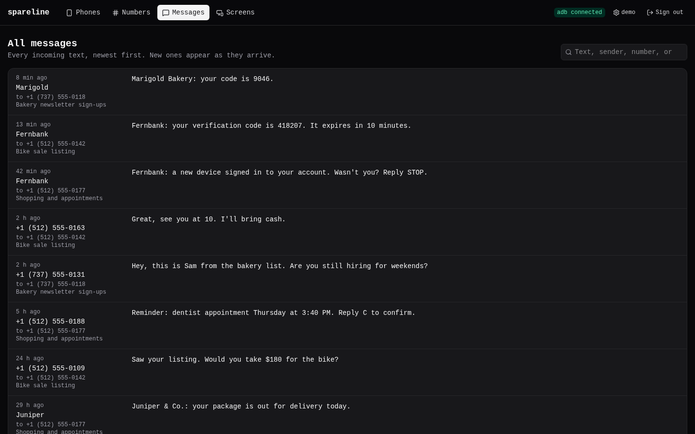

# spareline

[](https://github.com/265866/spareline/actions/workflows/ci.yml?query=branch%3Amain)
[](https://github.com/265866/spareline/releases/latest)

spareline turns old Android phones plugged into a small Linux server into phone lines you read from
a browser. Every text each SIM receives lands in that number's inbox, so you can give out spare
numbers for sign-ups, listings and verification codes and read them all in one place. It is for one
person or a household with a few spare phones, a SIM in each slot you want to use, and a server
such as a Raspberry Pi.

Unlike a VoIP number from an online service, each number is a real SIM in a phone you own. Unlike an
app on each phone that forwards its texts, no app is installed on the phones: spareline reads them
over USB through adb, Android's debugging bridge, so each phone only needs USB debugging turned on.
Texts stay in a database on your server, and spareline sends them nowhere. It only receives: to
reply or call, use the phone, or its screen from the browser.

- **An inbox for every number.** A dual-SIM phone gives two lines. Each number keeps a note, such
  as where you gave it out. See [Use the web app](docs/web-app.md).
- **Each phone's health.** Battery, temperature, and each SIM's carrier, service and signal.
  A phone that hasn't allowed the server yet says what to tap. See [Pages](docs/web-app.md#pages).
- **Search.** Every text to every number, by text, sender, number or note. See
  [Pages](docs/web-app.md#pages).
- **Screens in the browser.** Watch a phone's screen live and use it with taps, swipes and your
  keyboard, without picking it up. See [Pages](docs/web-app.md#pages).
- **Radios that stay off.** With a policy profile, spareline checks every phone every five minutes,
  turns mobile data, roaming, Wi-Fi, Bluetooth or location off again if one came back on, and
  flags the profile's other settings when they change. See
  [Settings](crates/spareline/deploy/podman/README.md#settings).
- **An HTTP API.** Read-only and full API keys for scripts, with the reference served at
  `/api/docs`. See [Pages](docs/web-app.md#pages).
- **Updates that check the phones first.** The Podman kit looks for a new release every hour, tries
  it against the phones before switching, and goes back to the old image and database if it
  doesn't come up healthy. See [Updates](crates/spareline/deploy/podman/README.md#updates).
- **Daily backups** of the database and the server's adb key. MMS pictures aren't included. See
  [Backups](crates/spareline/deploy/podman/README.md#backups).

[](docs/web-app.md#screenshots)

See every page, on a desktop and on a phone, in [Screenshots](docs/web-app.md#screenshots).

## Quick start

You need a Linux server for the phones to plug into, with `sudo`; an Android phone with a SIM; and
a computer with SSH, Git and a browser. In the commands, `HOST` is the server's SSH name.

1. Prepare the server. On Debian 13 or a Raspberry Pi OS based on it:

   ```sh
   sudo apt install podman passt adb
   sudo loginctl enable-linger "$USER"
   sudo usermod -aG plugdev "$USER"
   ```

   On a Raspberry Pi, also turn on the memory cgroup as
   [Prerequisites](crates/spareline/deploy/podman/README.md#prerequisites) says. Then reboot, so
   your services start with the `plugdev` group, which gives the adb server the phones' USB.

2. On your computer, copy the deploy kit to the server and run its installer:

   ```sh
   git clone https://github.com/265866/spareline.git
   cd spareline/crates/spareline/deploy/podman
   ssh HOST 'mkdir -p ~/services/spareline'
   scp -r ./. HOST:services/spareline/
   ssh HOST 'bash ~/services/spareline/install.sh'
   ```

   `install.sh` pulls the image, starts the adb server and spareline as your user's services, and
   turns on the hourly update and the daily backup.

3. On the phone, turn on USB debugging: in **Settings > About phone**, tap **Build number** seven
   times, then turn on **USB debugging** in **Developer options**. Plug the phone into the server.
   When it asks "Allow USB debugging?", tick **Always allow from this computer** and tap **Allow**.
   The hourly update tests a new release against the phones, so it waits until one is online.

4. Make an account. The command prints its password once:

   ```sh
   ssh HOST 'podman exec spareline spareline users add NAME'
   ```

5. spareline listens only on the server itself, so forward its port to your computer:

   ```sh
   ssh -N -L 8740:127.0.0.1:8740 HOST
   ```

   Open <http://127.0.0.1:8740> and sign in. The phone shows on **Phones**, and its texts, the ones
   already on it included, show under **Numbers** and **Messages**.

To reach spareline from your other devices over HTTPS, put a proxy such as Tailscale Serve or Caddy
in front of it, as step 4 of [Install](crates/spareline/deploy/podman/README.md#install) shows.

## Documentation

- [Use the web app](docs/web-app.md): what each page shows, with desktop and phone screenshots.
- [Run with Podman](crates/spareline/deploy/podman/README.md): install, configure, update, back up and restore spareline on the phones' server.
- [Container image](docs/install.md): the image's tags, and running it with Docker.
- [Verify a release](docs/verifying-releases.md): check that a download came from this repository.
- [Design](docs/design.md): the goals, the architecture, and the decisions behind them.
- [Stability](docs/stability.md): what a release can change, and what to read before you upgrade.
- [Code style](docs/style.md): the style rules a tool checks, and the review checklist for the rest.
- [Contributing](CONTRIBUTING.md): set up, run the checks, and send a change.
- [Maintain](docs/maintaining.md): the owner's repository settings, releases and trellis updates.
- [Security policy](SECURITY.md): how to report a vulnerability.
- [Changelog](CHANGELOG.md): what changed in each release.

## License

Released under either the [MIT License](LICENSE-MIT) or the [Apache License 2.0](LICENSE-APACHE), at
your option.

The image holds the licenses of the crates it is built with in
`/usr/share/doc/spareline/THIRD-PARTY-LICENSES.html`.
