# Use the web app

Read this to find your way around spareline's web app: what each page shows and what you can do
there. Open it at the address you reach spareline on, sign in with an account from
`spareline users add`, and every page updates by itself as phones change and texts arrive.

## Pages

| Page | Shows | You can |
| --- | --- | --- |
| **Phones** | Every phone spareline has seen: whether it's online, its battery, temperature and power source, and for each SIM slot the carrier, service, signal, whether mobile data is on, the number and the ICCID. A phone that hasn't allowed this host yet says what to tap. With a policy profile, each phone also shows whether its settings follow the profile. Below the phones, the recent activity: SIMs inserted, numbers linked, phones going on and offline. | See at a glance which lines are working. With a profile, select **Check now** to check a phone's settings at once, or **Set up phone** to apply the profile to it after you confirm. Setting a phone up can remove apps and their data, as the profile lists. |
| **Numbers** | Every phone number, with its note, the phone and SIM slot it's in, and its service and signal. | Search by any part of a number however it's written, its note, or its phone. Edit a note, such as where you gave the number out. |
| **A number** | One number's texts, newest first, with where its SIM sits and whether spareline read the number from the SIM or a person typed it. | Read its inbox. Enter the number if the SIM doesn't report one, or correct it if the SIM reports a wrong one, and edit its note. |
| **Messages** | Every text to every number, newest first, each with the number it went to and that number's note. | Search texts, senders, numbers and notes. |
| **Screens** | The phones that are online. | Open a phone to watch its screen live and control it with taps, swipes, scrolling and your keyboard. Video needs HTTPS or `localhost`. |
| **Settings** | Your account and its API keys. Open it with your name at the top right. | Change your password. Make a read-only or a full API key for a script, and revoke one. |

The API that the web app uses is documented at `/api/docs` on your spareline, without signing in.

## Screenshots

The screenshots show invented phones, numbers and texts from a demo run, not a real installation.
Each row shows a page on a desktop and on a phone. Select an image to see it at full size.

| Page | Desktop | Phone |
| --- | --- | --- |
| **Phones:** two phones online with three SIMs between them, and one waiting for approval. The demo's invented model isn't one spareline has verified its identity probe on, so each online phone shows a probe warning. | [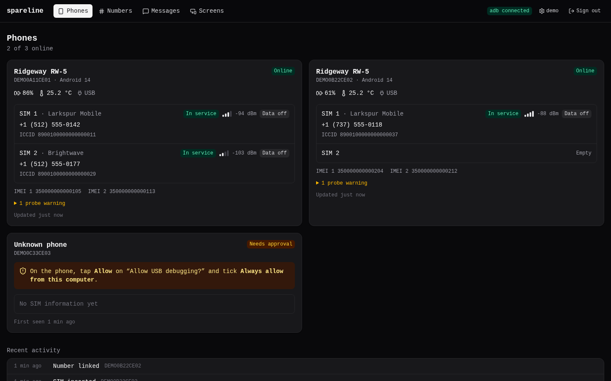](screenshots/phones.png) | [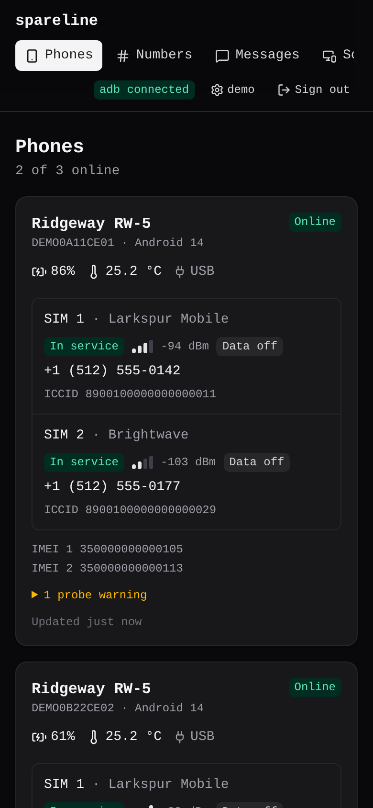](screenshots/phones-mobile.png) |
| **Numbers:** each number with its note, its phone and SIM slot, and its signal | [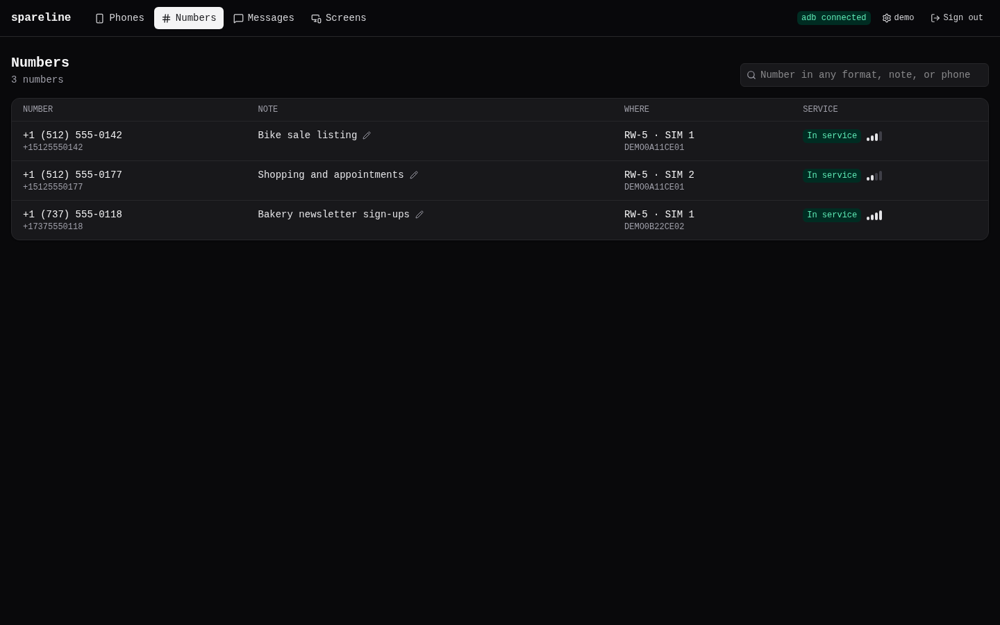](screenshots/numbers.png) | [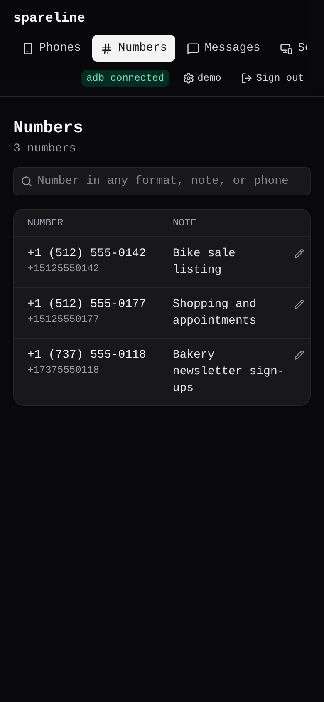](screenshots/numbers-mobile.png) |
| **A number:** the texts one number received | [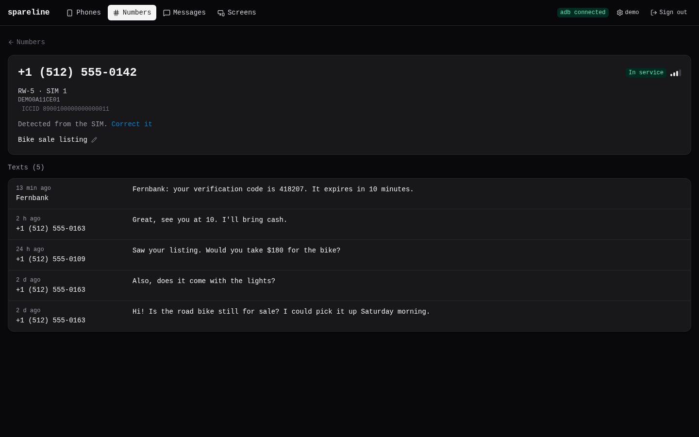](screenshots/number.png) | [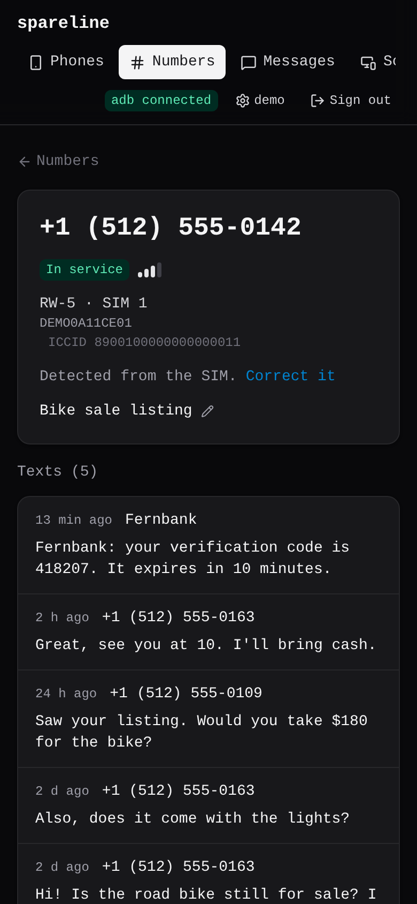](screenshots/number-mobile.png) |
| **Messages:** every text to every number, newest first | [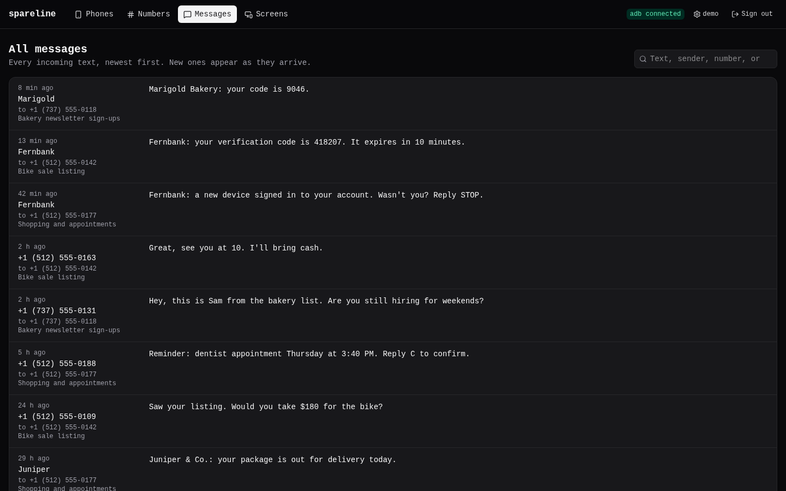](screenshots/messages.png) | [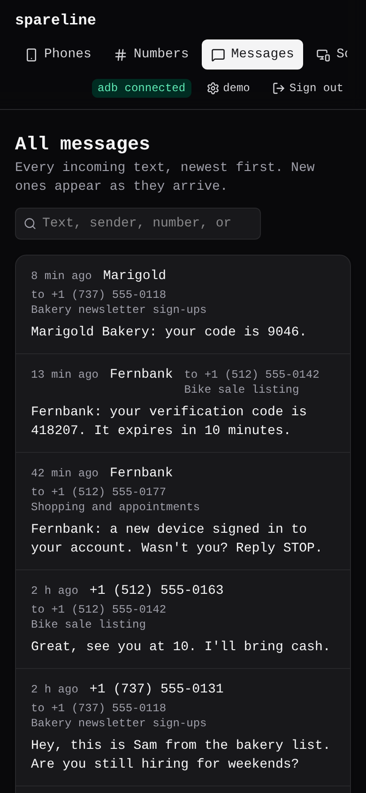](screenshots/messages-mobile.png) |
| **Messages, searched:** the texts from one sender | [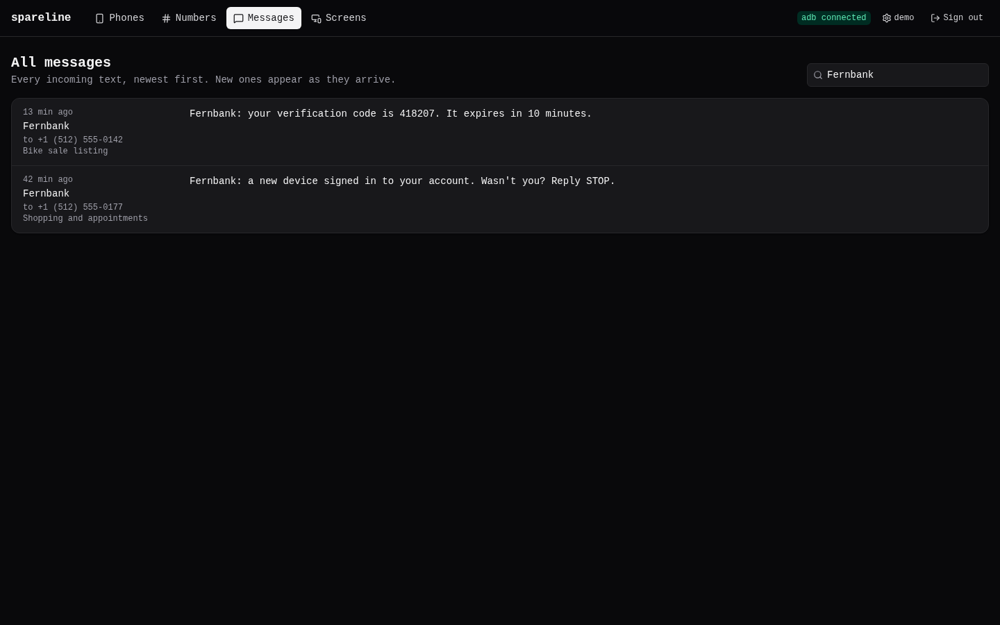](screenshots/messages-search.png) | [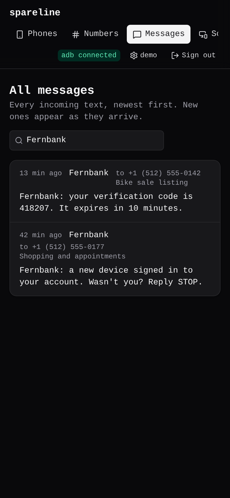](screenshots/messages-search-mobile.png) |
| **Settings:** your password and your API keys | [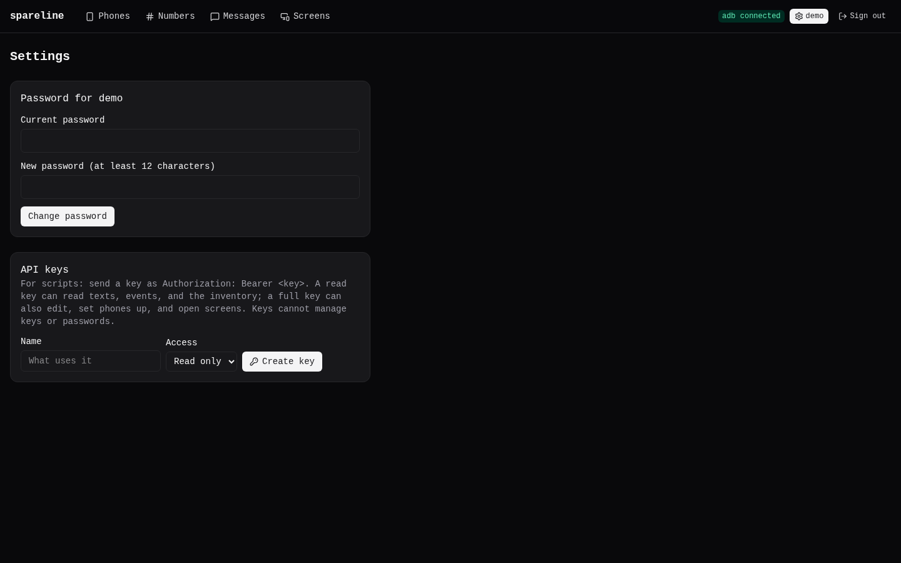](screenshots/settings.png) | [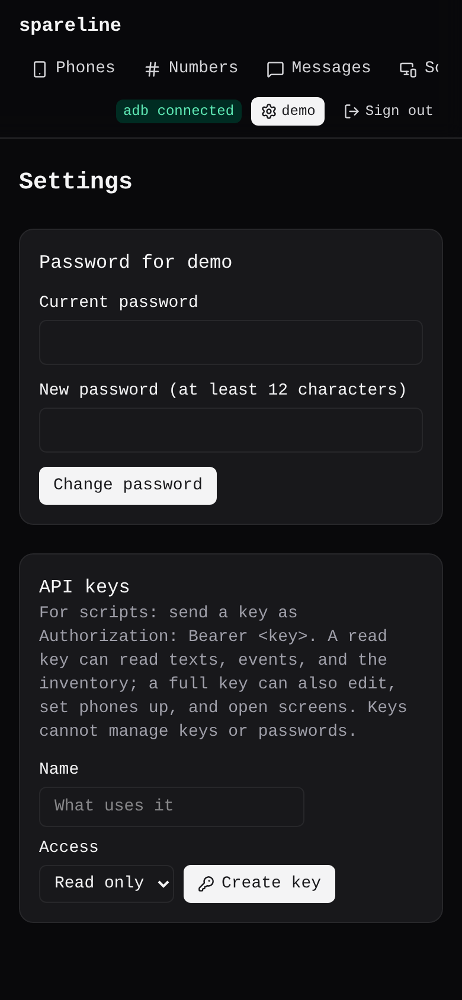](screenshots/settings-mobile.png) |
| **Sign in** | [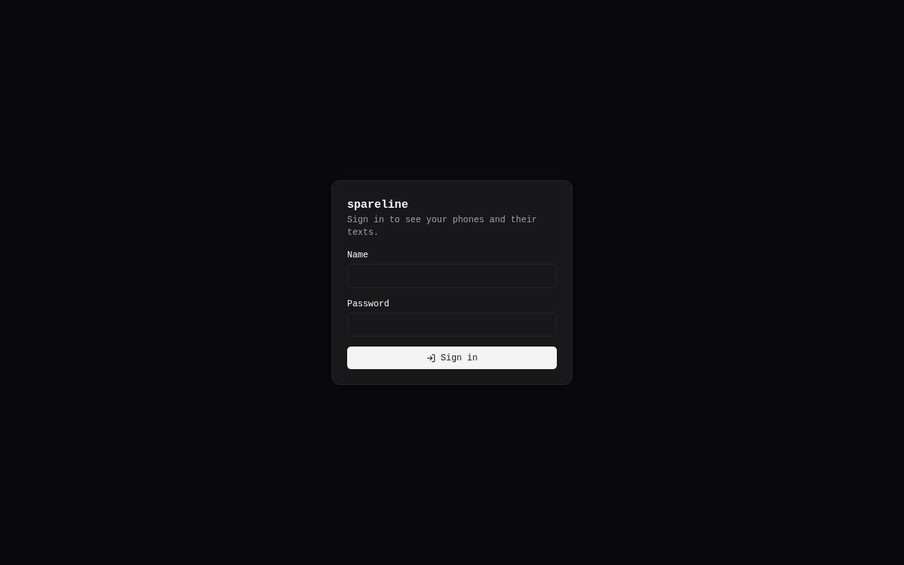](screenshots/sign-in.png) | [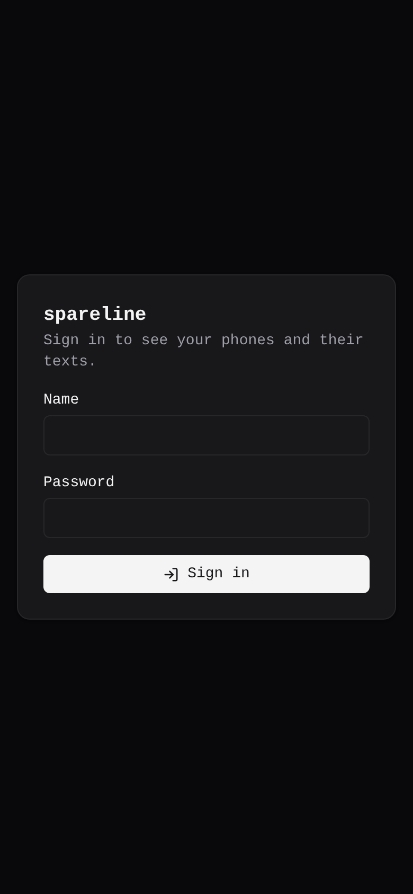](screenshots/sign-in-mobile.png) |

The Screens page has no screenshot: its video comes from a real phone, which the demo doesn't have.
